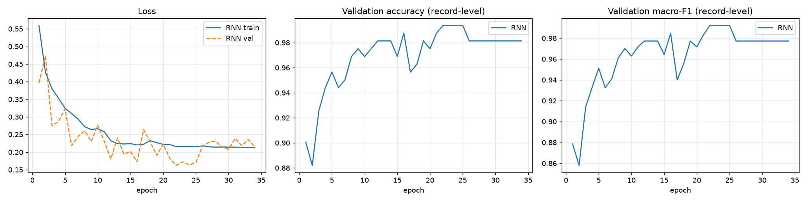
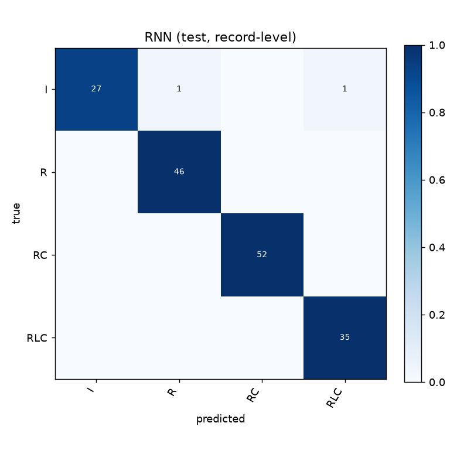
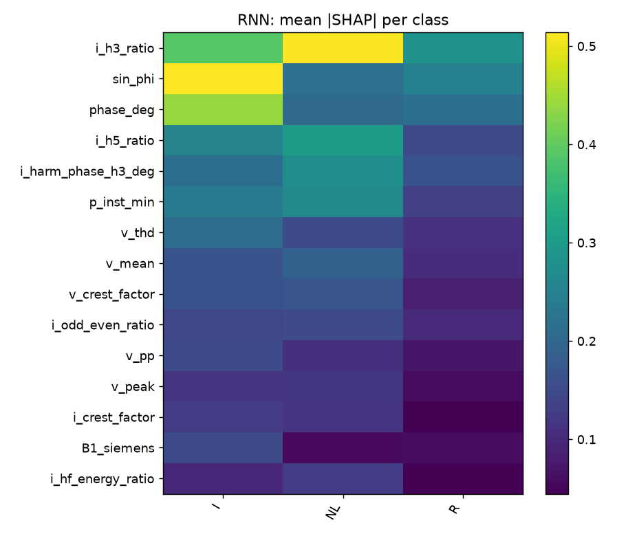
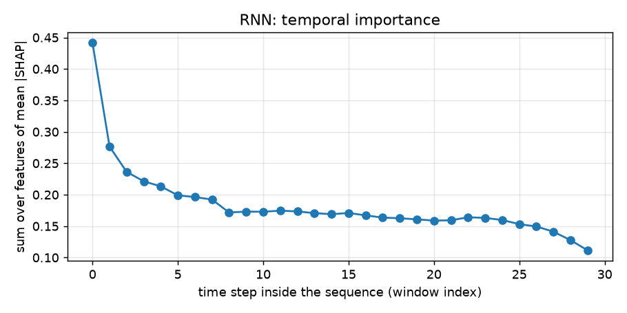

# Load classification: sequential model report

## 1. Setup

| item | value |
|---|---|
| features file | features/all_features.csv |
| target | load |
| classes | 3 |
| records | 1074 |
| windows per record (min/median/max) | 60 / 180 / 806 |
| feature count used | 53 |
| excluded columns | f0_Hz |
| sequence length (windows) | 30 |
| chunks train/val/test | 18916 / 1067 / 1060 |
| architecture | 2-layer, hidden=64, dropout=0.3, bidirectional=False |
| optimiser | AdamW lr=0.002 wd=0.001, batch=64, label-smoothing 0.05, class-weighted CE, grad-clip 1.0, input noise 0.05 |
| early stopping | val loss, patience 12 |
| seed | 42 |
| device | cpu |

## 2. Data split (by record id, stratified)

| class | train | val | test |
|---|---|---|---|
| I | 134 | 28 | 29 |
| NL | 404 | 87 | 87 |
| R | 213 | 46 | 46 |
| **total records** | 751 | 161 | 162 |

## 3. Headline comparison (test set, record-level)

| metric | RNN | RandomForest (baseline) |
|---|---|---|
| accuracy | 0.9630 | 0.9753 |
| balanced_accuracy | 0.9693 | 0.9693 |
| macro_f1 | 0.9557 | 0.9696 |
| weighted_f1 | 0.9634 | 0.9752 |
| macro_precision | 0.9444 | 0.9703 |
| macro_recall | 0.9693 | 0.9693 |
| cohen_kappa | 0.9392 | 0.9588 |
| mcc | 0.9404 | 0.9590 |
| log_loss | 0.1710 | 0.1486 |
| top3_accuracy | - | - |
| roc_auc_macro_ovr | 0.9870 | 0.9952 |
| accuracy 95% CI | [0.932, 0.988] | [0.951, 0.994] |
| macro-F1 95% CI | [0.918, 0.987] | [0.936, 0.995] |

## 4. Training summary

| model | params | epochs run | best epoch | train time (s) | chunk-level test acc | chunk-level test macro-F1 |
|---|---|---|---|---|---|---|
| RNN | 24387 | 34 | 22 | 204.1 | 0.9509 | 0.9411 |
| RandomForest (baseline) | - | - | - | 3.7 | nan | nan |

## 5. Detail: RNN

| class | precision | recall | f1 | support | AUC (OvR) |
|---|---|---|---|---|---|
| I | 0.8750 | 0.9655 | 0.9180 | 29 | 0.9743 |
| NL | 1.0000 | 0.9425 | 0.9704 | 87 | 0.9917 |
| R | 0.9583 | 1.0000 | 0.9787 | 46 | 0.9949 |

Most frequent confusions (true -> predicted, count):

| true | predicted | count |
|---|---|---|
| NL | I | 4 |
| I | R | 1 |
| NL | R | 1 |

## 5. Detail: RandomForest (baseline)

| class | precision | recall | f1 | support | AUC (OvR) |
|---|---|---|---|---|---|
| I | 0.9643 | 0.9310 | 0.9474 | 29 | 0.9984 |
| NL | 0.9884 | 0.9770 | 0.9827 | 87 | 0.9926 |
| R | 0.9583 | 1.0000 | 0.9787 | 46 | 0.9947 |

Most frequent confusions (true -> predicted, count):

| true | predicted | count |
|---|---|---|
| I | NL | 1 |
| I | R | 1 |
| NL | I | 1 |
| NL | R | 1 |

## 6. How to read this

- Headline numbers are **record-level** (chunk probabilities averaged per record), computed on records never seen in training.
- Macro-F1 / balanced accuracy matter more than accuracy if classes are imbalanced.
- If the test set is small the CIs above are wide; differences between models inside the CI are not significant.
- The RandomForest row uses per-record mean/std/min/max of the same features; if the RNN/LSTM does not beat it, the temporal structure is not adding much.
- PLAID has several records per physical appliance; a split by id can still put the same appliance in train and test, so real-world generalisation may be lower.

## 7. SHAP feature attribution (GradientExplainer)
SHAP values are in logit units, computed on standardised features. Importance = |sum of SHAP over the sequence's time steps| averaged over explained test chunks and classes. Plots and full tables are in `shap_<model>/`.

### RNN (additivity error 1.5319 logits)
| rank | feature | mean |SHAP| |
|---|---|---|
| 1 | i_h3_ratio | 0.3951 |
| 2 | sin_phi | 0.3287 |
| 3 | phase_deg | 0.2878 |
| 4 | i_h5_ratio | 0.2361 |
| 5 | i_harm_phase_h3_deg | 0.2187 |
| 6 | p_inst_min | 0.2116 |
| 7 | v_thd | 0.1583 |
| 8 | v_mean | 0.1519 |
| 9 | v_crest_factor | 0.1398 |
| 10 | i_odd_even_ratio | 0.1329 |

